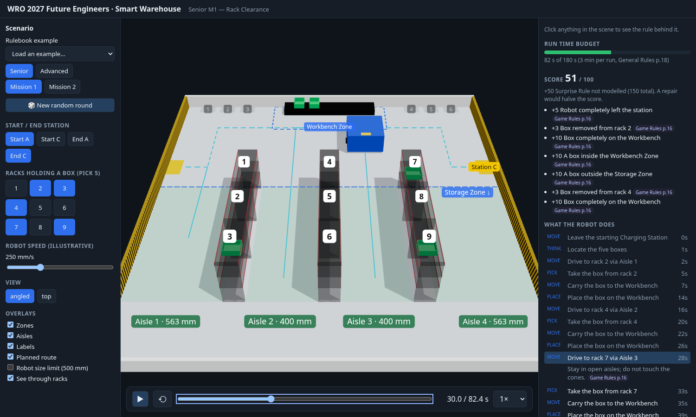
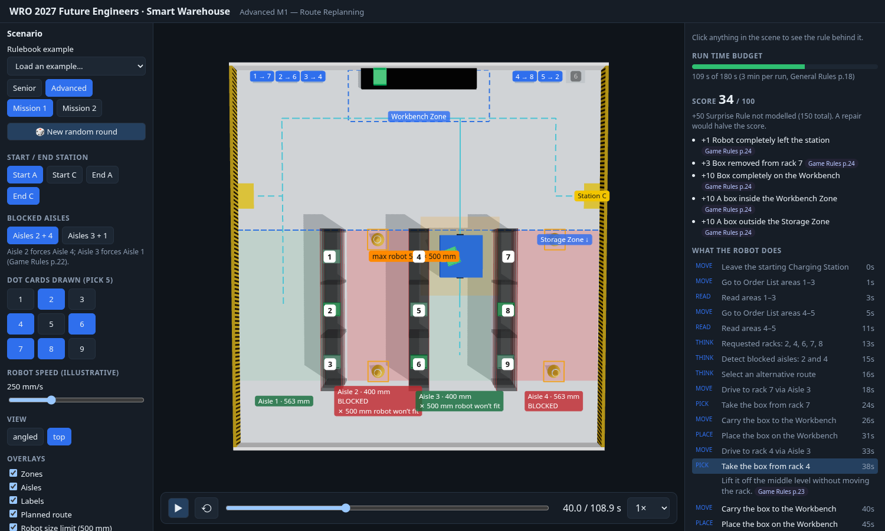
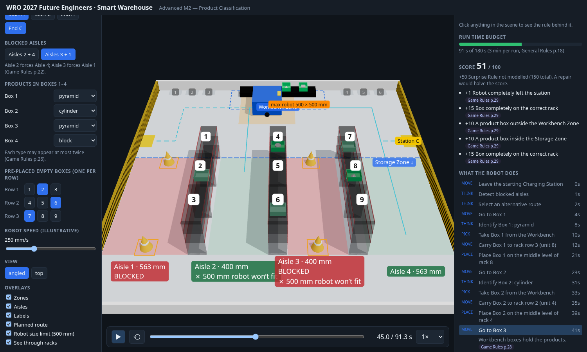

# WRO 2027 Future Engineers — Smart Warehouse visualiser

An interactive 3D study tool for the **WRO 2027 Future Engineers** challenge ("Smart Warehouse"). Pick a rulebook
example or a random round, press play, and watch what the robot has to do: the field, the racks and boxes, the route
it must take around blocked aisles, the 180 s run budget, the 500 mm robot size limit against the aisle widths, and
the score as it accrues. Click any object to see the rule behind it, with its PDF page.

**Live: <https://wro.ralvarez.dev/fe/2027/>**



| Advanced M1, top view: blocked aisles, cones, 500 mm limit | Advanced M2: products sorted onto the right rack rows |
|---|---|
|  |  |

> Unofficial fan/study project. It is not affiliated with or endorsed by the World Robot Olympiad Association.
> The official rulebooks are the only authority; where this app and the rulebooks disagree, the rulebooks win.

## What it shows

- **All four missions are playable** (Senior and Advanced, missions 1 and 2), as rulebook examples or random rounds
  that follow the rulebook's randomisation rules.
- **The robot's job, step by step**: a timeline of leave station → read cards → detect blocked aisles → pick → carry →
  place → park, each step with the rule and PDF page it comes from. Click a step to jump to it.
- **Limits made visible**:
  - the run-time bar against the 3 minute limit (turns red when the plan would not finish in time),
  - the live score against the 100 points the model can award (the Surprise Rule's +50 is not modelled),
  - an overlay that draws the maximum 500 × 500 mm robot footprint, so you can see it does not fit the two 400 mm aisles,
  - blocked aisles, cones, Workbench and Storage zones, aisle widths and rack numbering.
- **Provenance on everything**: click any object (field, rack, Workbench, box, station, cone, aisle…) to list its
  facts, each tagged with where it comes from: `text`, `figure`, `derived`, or `assumed`.
- **Editable rounds**: start and end station, blocked aisle pair, which five racks, which products and where the
  pre-placed boxes are, plus an adjustable (illustrative) robot speed, view presets and overlay toggles.

## The challenge in short

The field is 2362 × 2286 mm with 100 mm walls: three rack rows (three units each, three levels), a Workbench at the
top wall, two Charging Stations, and up to nine open boxes. Numbers below are from the Game Rules; the full cited
digest is in [`docs/guides/`](docs/guides/).

| Mission | What the robot does | Score (max, plus 50 Surprise Rule) |
|---|---|---|
| Senior 1 · Rack Clearance | Find five boxes on the racks, carry them to the Workbench, park | 100 (+50 = 150) |
| Senior 2 · Order Picking | Read five dot cards, fetch only those five of nine boxes, park | 100 (+50) |
| Advanced 1 · Route Replanning | Senior 2, with two aisles closed by cones; never enter them | 100 (+50) |
| Advanced 2 · Product Classification | Identify four products on the Workbench, shelve each box on the right rack row | 100 (+50) |

In Advanced 2, rectangular blocks go to rack units 1–3, cylinders to 4–6 and pyramids to 7–9, on the middle level of an
unoccupied unit. The robot may be at most 500 × 500 × 500 mm and 6.0 kg, and an official run lasts at most 3 minutes.
A repair during a run halves the score.

## Accuracy: what is a rule and what is an assumption

Everything in `src/rules/` carries a citation (`Cite`) naming the PDF page and how the value was obtained:

| Kind | Meaning |
|---|---|
| `text` | stated in the body text of the rulebook |
| `figure` | read from a figure label (checked by rendering the page) |
| `derived` | computed from other values, e.g. row length 960 = 4 × 15 + 3 × 300 |
| `assumed` | **not in the rulebooks**; the app picks a plausible value and says so |

Assumed values: charging-station offsets along the wall, Workbench Zone and Order List Area coordinates, the Storage
Zone line, cone-square positions, wall thickness, and the rule that crossing the open front gap in front of a blocked
aisle is allowed. Also not modelled: the Surprise Rule and the Secret Mission, whose content the PDFs do not give.
Robot speed (default 250 mm/s) and grip/read times are illustrative; only the 180 s run limit is a rule.

Remaining open questions are listed at the end of each digest in [`docs/guides/`](docs/guides/).

## Getting started

Requires Node 22+ and [pnpm](https://pnpm.io/).

```sh
pnpm install
pnpm dev        # http://localhost:5173
pnpm test       # vitest: field geometry, planner, playback
pnpm lint       # tsc --noEmit (strict)
pnpm build      # typecheck + static site in dist/fe/2027/
pnpm preview    # serve the production build at http://localhost:4173/fe/2027/
```

The official PDFs are **not** in this repository (they are © World Robot Olympiad Association Ltd.). Download the
2027 Future Engineers *Game Rules* and *General Rules* from <https://wro-association.org> and keep them in the repo
root if you want to re-check the digests; `WRO-*.pdf` is gitignored. The app itself does not need them.

## How it works

```
src/rules/       typed field geometry, limits and scoring, each value with a PDF-page Cite
src/scenarios/   ScenarioSetup  →  buildPlan()  →  Plan (timed segments)  →  stateAt(plan, t)
src/scene/       react-three-fiber rendering only; reads one computed state per frame
src/ui/          controls, timeline, score, steps, provenance panel
src/state/       zustand store (setup, plan, playback clock, overlays)
tests/           vitest for rules and planner logic
```

- **Scenarios are data.** A `ScenarioSetup` (category, mission, stations, blocked aisles, requested racks, cards,
  products) is declarative. `buildPlan` turns it into a `Plan`: an ordered list of timed segments (move, pick, place,
  read, think, park) with score events attached.
- **Routing** is a small waypoint graph (aisle lanes, a top lane in front of the Workbench, a front lane) searched with
  Dijkstra. A blocked aisle loses every edge that reaches the rack zone, so the planner can only use the open side of
  each row. A test asserts that no planned route ever enters a blocked aisle.
- **Playback is a pure function**: `stateAt(plan, t)` gives the robot pose, every box pose, the box being carried and
  the score at time `t`. The 3D scene and the tests both use it; no React or Three.js is involved in the rules logic.
- **Every plan scores exactly 100** (the rules' 150 minus the 50 Surprise Rule points), which the tests check for the
  rulebook examples and a batch of random rounds.
- **Coordinates** are millimetres with the origin at the Workbench-wall/left-wall corner, `x` across the width, `z`
  toward the open front and `y` up; the scene recentres them.

Stack: Vite, TypeScript (strict), React 19, react-three-fiber and drei, zustand, vitest. See
[ADR 0001](docs/adr/0001-app-stack-vite-react-r3f.md) for why.

## Deploying

The app is a static site served by a Cloudflare Worker with static assets, no Worker code, at a path
(`wro.ralvarez.dev/fe/2027`). Assets are matched by full request path, so the build is emitted to `dist/fe/2027/` and
Vite's `base` is `/fe/2027/`.

```sh
cp .env.example .env     # token file reference, account id, SITE_HOST, SITE_PATH, SITE_ZONE
pnpm deploy:dry          # build and check the generated route config
pnpm deploy              # build, then wrangler deploy
```

`scripts/deploy.mjs` writes a git-ignored `wrangler.deploy.jsonc` with the route `host + path*` and runs
`wrangler deploy`. The API token is read from a file by reference (`CLOUDFLARE_API_TOKEN_FILE`) and never lives in the
repo. A path route cannot be a Custom Domain, so `SITE_HOST` needs a proxied DNS record in the zone (for example
`AAAA wro 100::`). `/fe/2027` redirects to `/fe/2027/`; security and cache headers come from `deploy/_headers`.

## Documentation

The project follows a `docs/` tree maintained with the `docs-architect` skill:

- [`docs/guides/`](docs/guides/): cited rules digests: [field](docs/guides/rules-field.md),
  [senior missions](docs/guides/rules-senior-missions.md), [advanced missions](docs/guides/rules-advanced-missions.md),
  [general rules](docs/guides/rules-general.md).
- [`docs/adr/`](docs/adr/): architecture decisions.
- [`docs/plans/`](docs/plans/) and [`docs/backlog/`](docs/backlog/): scope, exit criteria and the work queue.

`AGENTS.md` is the guide for coding agents; skills are pinned with `rsk` in `.rsk/`
(symlinks in `.claude/skills/` are git-ignored; `rsk install` restores them).

## Roadmap

Resolve the assumed placements against the physical field or WRO Q&A, model the Surprise Rule and Secret Mission once
their content is known, add assertions to the browser smoke test (`scripts/screenshot.mjs`), split the bundle and add
eslint. See [`docs/backlog/wro-fe-2027.md`](docs/backlog/wro-fe-2027.md).

## License

No license has been chosen yet; until one is added, all rights are reserved by the author. World Robot Olympiad and the
WRO logo are trademarks of the World Robot Olympiad Association Ltd.
